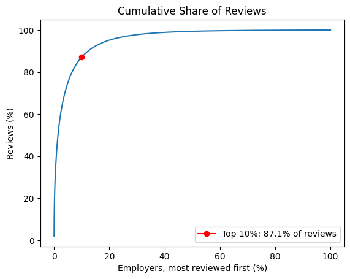
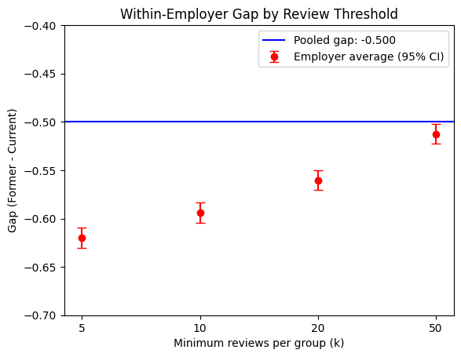
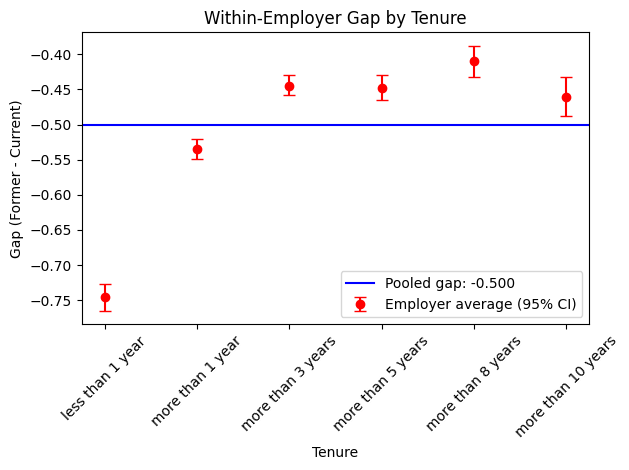
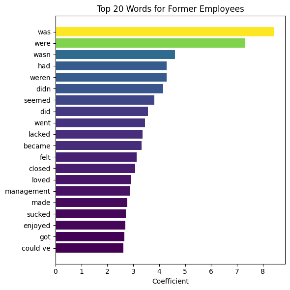
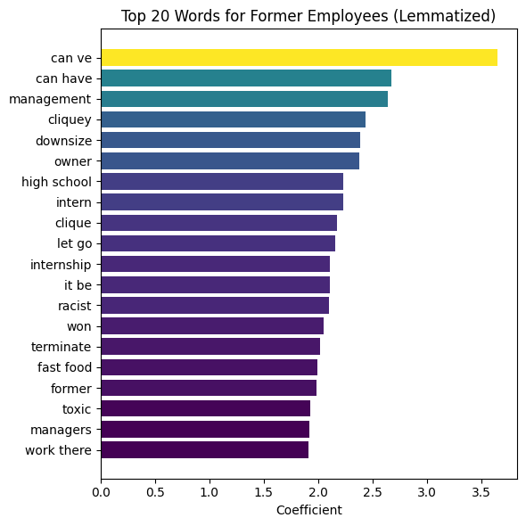
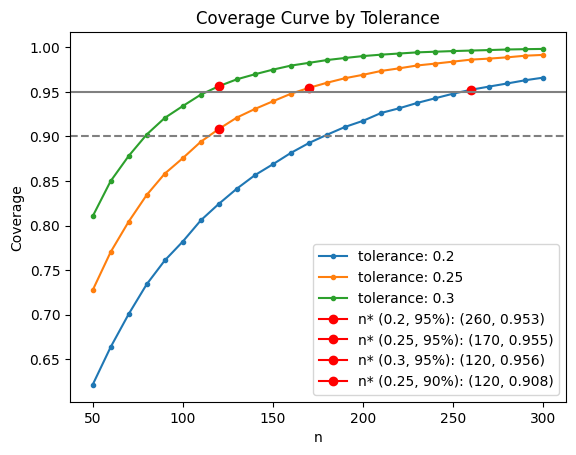

## 0. Abstract

This study asks whether an employer page should include a "What Former Employees Say" section, and if so, for which employers. Using almost 5M Glassdoor reviews from 2020 onward, we compare former and current employees of the same employer in three ways. [1] Former employees rate their employer 0.594 points lower than current employees. [2] Their Cons text separates them from current employees with the same rating with an AUC of 0.628, and 0.593 after merging past and present verb forms. [3] However, an employer needs about 170 reviews from both former and current employees to estimate its gap within ±0.25, and only 7.0% of employers in the data have that many. The gap is real and visible in text, but in our data, only a small group of large employers can show it reliably.

## 1. Introduction

### 1.1 Background

Employer pages usually combine all ratings into one average, but prior work does not show whether former employees differ enough to be shown separately. If they do, a separate section for former employees could give job seekers a fuller view of an employer. Prior work links review ratings and text to employment status with large language model scores (Sheykhi et al., 2026), topic models limited to tourism and hospitality (Stamolampros et al., 2019), and descriptive comparisons of four technology firms (Pan et al., 2023). None of these studies compares former and current employees who work for the same employer and give the same rating, or asks how many reviews such a comparison needs. We therefore ask whether former employees rate the same employer lower (RQ1), whether their Cons text still differs at the same rating (RQ2), and how many reviews an employer needs to show the gap reliably (RQ3).

### 1.2 Data

We use a public set of 9.9 million Glassdoor reviews and keep the 4,950,343 reviews written by regular employees from 2020 onward. The data come from [Glassdoor Job Reviews 2](https://www.kaggle.com/datasets/davidgauthier/glassdoor-job-reviews-2) on Kaggle ([CC BY-NC-SA 4.0](https://creativecommons.org/licenses/by-nc-sa/4.0/)), and each review has a rating from 1 to 5, a Cons text, a self-reported current or former status, and a date. We removed 435,648 duplicates and 428 rows with missing values, and excluded interns and contractors, for whom "former" often means only that a contract ended. The final sample covers 27,728 employers, with 41% of reviews from former employees. However, these reviews are unevenly distributed across employers.

### 1.3 Problem

The main problem in these data is that reviews are concentrated in a few employers, so every step of our analysis had to account for this skew. The median employer has only 7 reviews, while the mean is 178.5, and the top 10% of employers hold 87.1% of all reviews (Figure 1). If we analyzed reviews directly, a few large employers would drive every result, and the gaps of small employers would be mostly noise. Table 1 shows how we handled the skew at each step. We required a minimum number of former and current reviews per employer, which, at 10 reviews, removes 69.2% of employers but only 2.2% of reviews. We then gave each employer equal weight, resampled employers rather than reviews for CIs, and kept each employer in a single data split for RQ2. We also reran RQ1 with thresholds from 5 to 50 and reported both employer and review shares for RQ3. These choices keep a few large employers from deciding our results. The skew is also a question in itself: RQ3 asks how many reviews an employer needs, and therefore how many employers can show the section at all.

| Step | Risk from skew | What we did |
| :-- | :-- | :-- |
| Sample | Noisy small employers | Require k reviews per group (k = 10 drops 69.2% of employers, 2.2% of reviews) |
| Estimate (RQ1, RQ2) | Large employers dominate | Weight employers equally |
| Uncertainty | Reviews not independent | Resample employers for CIs |
| Split (RQ2) | Employer words leak | One split per employer |
| Robustness (RQ1) | Results depend on k | Rerun with k = 5 to 50 |
| Reporting (RQ3) | Employer and review shares differ | Report both shares |

## 2. Results

### 2.1 RQ1: Rating Gap

Former employees rate their employer clearly lower than current employees of the same employer, so H1 is supported. H1 expected this gap to be negative with a 95% CI below 0, and we treat a gap of at least 0.25 points as large enough to matter to users. For each of the 8,539 employers with at least 10 former and 10 current reviews, we computed the gap as the former mean rating minus the current mean rating, averaged the gaps with equal weight, and computed the CI from 2,000 bootstrap resamples of employers (Section 1.3). The average gap is −0.594 [−0.604, −0.583]. Its CI lies below 0, and its size is more than twice the 0.25-point threshold. Our baseline is the pooled gap of −0.500, the same difference computed across all reviews regardless of employer. The two differ by only −0.094, below 0.25, so the pooled gap is enough, and employer mix, if anything, hides a small part of the gap. The gap stays negative for thresholds from 5 to 50 reviews per group (−0.620 to −0.513), although it shrinks as only larger employers remain (Figure 2, left). Because former and current employees may differ in how long they stayed, we also computed the gap within each tenure band. It is negative in every band, from −0.746 for less than one year to −0.410 for more than eight years (Figure 2, right). Tenure is missing for 39.7% of reviews, but among reviewers who report it, tenure does not explain the gap. The rating gap is therefore a stable feature of former employees' reviews, not a product of employer mix or tenure. A rating gap alone, however, does not show what former employees say differently.

### 2.2 RQ2: Text Signal

Cons text distinguishes former from current employees of the same employer and rating, so H2a and H2b are supported, but part of this signal comes from tense rather than content. H2a expected the 95% CI of the AUC to exclude 0.5, and H2b expected "management" to be among the 20 words most linked to former employees. We kept employers with at least 5 former and 5 current reviews, split them by employer into training, validation, and test sets (64%, 16%, and 20%), and removed phrases that state status outright, such as "I left" and "so far", because they reveal status without describing the employer. We trained a logistic regression on TF-IDF unigrams and bigrams and chose its regularization strength on the validation set. We then scored pairs of one former and one current review from the same test employer with the same rating. The AUC is the share of these pairs in which the model scores the former review higher, so 0.5 means chance, and using only same-rating pairs tests what the text adds beyond the rating. TF-IDF reaches an AUC of 0.628 [0.622, 0.633] across 2,194 test employers. Our baseline, a model that uses only the number of words, stays at chance (0.502), so length alone does not separate the groups, and TF-IDF adds 0.126 [0.118, 0.133]. However, 19 of the top 20 words for former employees mark the past, such as "was", "were" and "could ve", and only "management" (rank 15) describes content (Figure 3, left). Former employees naturally describe their employer in the past tense, so these words reveal status rather than what they think of the employer. When we lemmatized verbs so that past and present forms match, the AUC fell to 0.593 [0.587, 0.598], and "management" rose to rank 3, alongside "cliquey", "downsize" and "toxic" (Figure 3, right). About 27% of the signal above chance, (0.628 − 0.593) / (0.628 − 0.5), thus comes from tense, and 73% remains without it. Sentence embeddings from EmbeddingGemma reached a lower AUC of 0.605 [0.600, 0.610] and do not show which words drive the prediction, so we kept TF-IDF. Cons text therefore separates former employees partly by tense and partly by what they write about, and "management" is the content word most strongly linked to former status. Both signals, however, are useful only for employers with enough reviews to show them.

### 2.3 RQ3: Reviews Needed

Most employers do not have enough reviews to estimate their gap reliably, so H3 is supported. H3 expected more than half of employers to have fewer than n\* reviews in at least one group, where n\* is the number of reviews per group needed to estimate the gap within ±0.25 in 95% of cases. The tolerance of 0.25 matches the smallest gap we treat as meaningful in RQ1. We used the 333 employers with at least 1,000 former and 1,000 current reviews as references, because their gaps are already precise to about ±0.11, and treated each one's gap from all its reviews as its reference gap. For each n from 50 to 300 in steps of 10, we drew n former and n current reviews with replacement 1,000 times and recorded how often the sample gap fell within ±0.25 of the reference gap. The smallest n at which this share, averaged across employers, exceeds 95% is n\* = 170 (164 on a finer grid; Figure 4). Our baseline is the normal approximation $n^* = 2(1.96\sigma/0.25)^2$, which gives 183 with σ = 1.22, the rating SD across all reviews. This σ also includes differences between employers; the SD within the reference employers is 1.15, which gives 163, close to the resampling result. Only 7.0% of all employers have at least 170 former and 170 current reviews, although they hold 81.0% of reviews. With n\* = 183 the share is 6.7%, so both methods lead to the same conclusion, and the formula is enough and slightly conservative. Across tolerances from 0.20 to 0.30 and levels of 90% and 95%, n\* ranges from 120 to 260, and the share of employers stays between 5.1% and 9.0%. A reliable gap is therefore available only for a small group of large employers, which nonetheless hold most of the reviews.

## 3. Implications

### 3.1 Product Decision

Our results support adding a "What Former Employees Say" section, but only for employers with enough reviews. Table 2 links each finding to a product decision. Because former employees rate the same employer about 0.6 points lower, more than the 0.25 points we treat as meaningful, the section should show their ratings separately rather than fold them into one average. Since their Cons text still differs at the same rating, and "management" is the content word most strongly linked to former status, the section can also show themes such as management, once tense and status phrases are removed. For example, it could place former and current employees' average ratings side by side and list the content words that most separate their Cons. Because a reliable gap needs about 170 reviews in each group, the section should appear only for employers that meet this bar, and other employers should keep the single combined rating. In our data, only 7% of employers meet it, but they hold 81% of reviews. This share depends on how the data were collected, so the product team should recount it on its own review data before launch.

| RQ | Finding | Decision |
| :-- | :-- | :-- |
| RQ1 | Former employees rate the same employer 0.594 points lower [−0.604, −0.583] | Show former employees' ratings separately |
| RQ2 | Cons text separates them at the same rating (AUC 0.628, 0.593 without tense); "management" is the top content word | Show themes such as management, with tense and status phrases removed |
| RQ3 | A reliable gap needs about 170 reviews per group; 7.0% of employers in our data have them | Show the section only for employers that meet this bar |

### 3.2 Limitations

These conclusions rest on data and methods with several limitations. Reviewers choose whether to post and report their own status, so our results describe associations among Glassdoor reviewers from 2020 onward, not the effect of leaving an employer. The data were also scraped, and it is unknown how employers were chosen, so the share of employers with enough reviews may differ on other review data. For RQ1, tenure is missing for 39.7% of reviews, so the tenure check covers only reviewers who report it. For RQ2, the AUC of 0.593 is an upper bound on the signal from content alone, because status words such as "let go" and "former" remain in the text. Training also uses all reviews, so large employers dominate it, even though evaluation weights employers equally. For RQ3, n\* comes from the 333 largest employers, and smaller employers may need more reviews if their ratings vary more. The direction of our findings is robust, but their exact sizes should be read as approximate.

### 3.3 Future Work

Future work should address the remaining status signals, the weight of large employers, and the value of the section to users. First, removing status words beyond tense, such as "let go" and "former", would give a cleaner estimate of the content signal. Second, estimating n\* from smaller employers would show whether 170 reviews are enough for them. Third, weighting RQ2 training by employer would match training to the equal-weight evaluation. Finally, testing the section with job seekers would show whether it changes how they judge employers. These steps would show how much of the difference lies in what former employees say, and whether showing it helps job seekers.